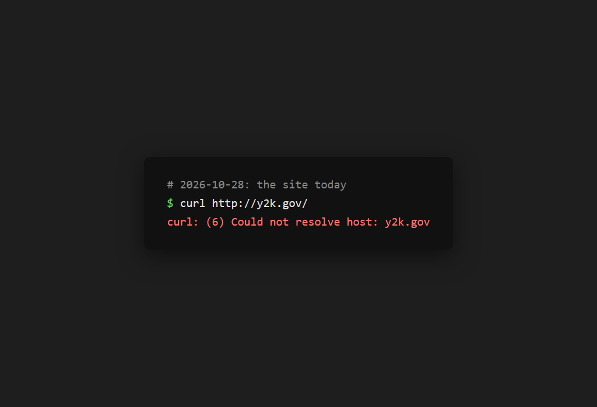
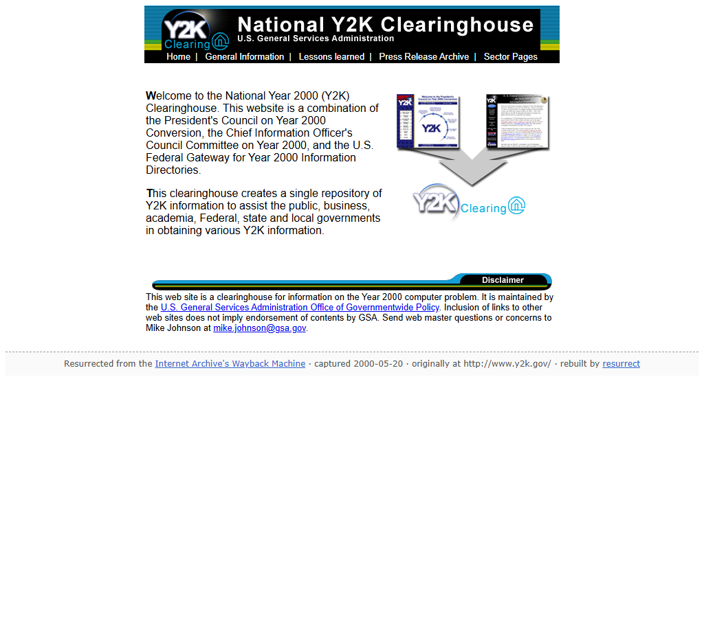
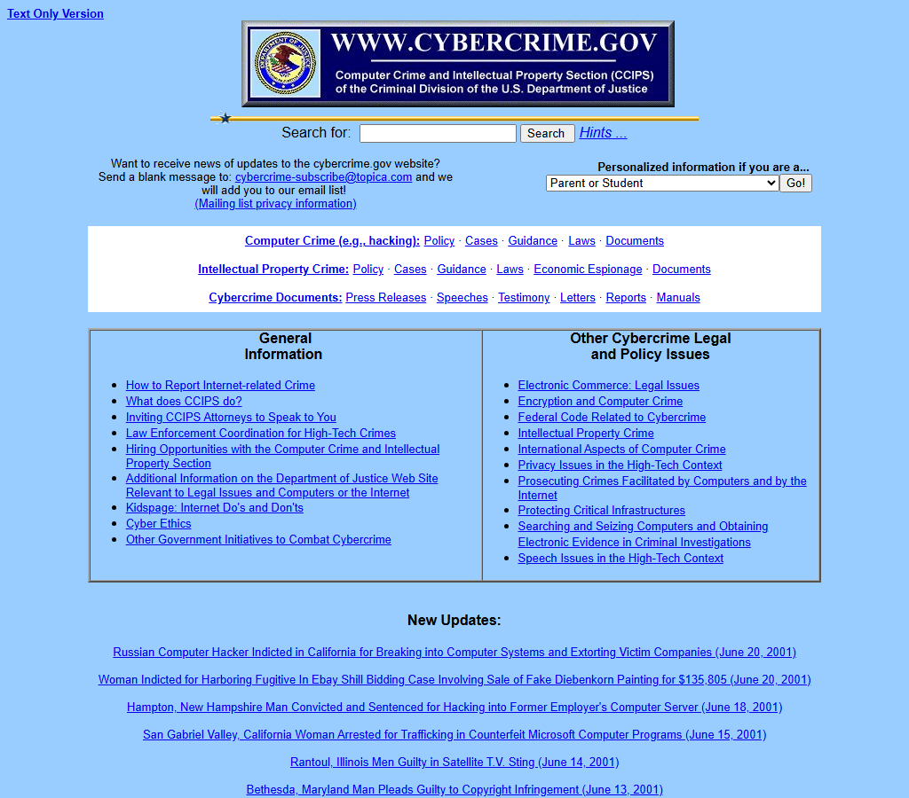
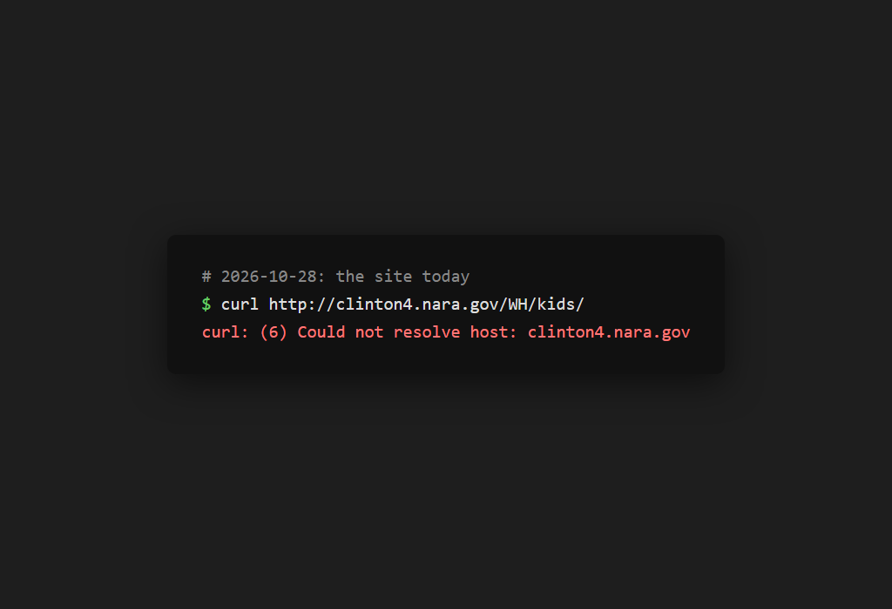
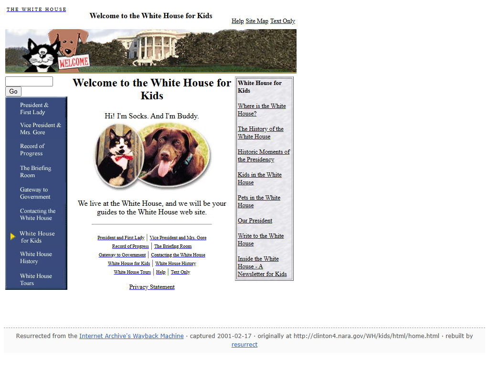

# resurrect

**Give it a dead website. Get the website back, working.**

```bash
npx github:dadwritestech/resurrect y2k.gov
npx github:dadwritestech/resurrect myoldblog.com --year 2006
```

resurrect asks the Internet Archive's Wayback Machine what it holds for a site. It picks the best
snapshot of every page for one moment in time and rebuilds the site as a plain static folder. The
pages keep their original look and their links work. You can open the folder locally, zip it, or
host it anywhere.

| before (today) | after (`npx github:dadwritestech/resurrect y2k.gov`) |
|---|---|
|  |  |
|  |  |
|  |  |

## Why not just a downloader?

Wayback downloaders give you **files**. You get thousands of files at their original paths, with
absolute links that still point at the dead domain. `/about` and `/about/index.html` end up as
different things, and every gap in the archive becomes a broken image. resurrect gives you **the
site**:

- **One argument.** It works out the www/bare-host equivalence and the date window itself. The
  default moment is the year the archive saw the most *distinct pages* of the site, so a
  parked-domain page crawled 500 times doesn't win.
- **Time travel.** `--year 2003` rebuilds the site as it was that year. The closest capture is
  chosen *per page*. If that capture is broken in the archive, the next-closest one fills the gap.
- **Every link works or explains itself.** Internal links become relative paths to local files.
  Pages the archive never captured go to a "this page was not archived" placeholder. Links to
  other websites go to their Wayback copy from the same date.
- **Old markup survives.** It handles frames, `<base>`, `BACKGROUND=`, image maps, meta refresh
  and inline `style=` and CSS `url()`. Bytes are preserved, so ISO-8859-1 pages stay ISO-8859-1.
  Scripts are left untouched.
- **A report.** `_resurrect/REPORT.md` lists what was recovered and what was lost. It also lists
  which pages were filled from a neighbouring snapshot, and how many days that snapshot is from
  the target.

## Use it for your own sites

resurrect is meant for **your own old sites and personal archival use**: your band's 2004 page,
your first blog, a project's lost docs. The content belongs to whoever wrote it, and the copy
comes from the Internet Archive. So by default:

- every page gets a small footer: *Resurrected from the Internet Archive's Wayback Machine ·
  captured 2000-05-08*
- every page gets `<meta name="robots" content="noindex,nofollow">` and the folder gets a
  `robots.txt` that disallows crawling. `--allow-indexing` turns both off; use it only for a site
  you own.

It is also polite to archive.org. It sends one request at a time, waits 1 second between
requests (`--delay`), and uses a clear User-Agent. It backs off on 429/5xx and honours
`Retry-After`. It caches every response on disk, so a second run costs zero requests. It never
contacts the dead domain itself: redirects that would leave archive.org are refused.

## Options

```
resurrect <url> [--year 2009] [options]

  --year <yyyy>        rebuild the site as it looked in this year
  --out <dir>          output folder (default: ./resurrected/<host>)
  --max-pages <n>      stop after n pages (default 300)
  --max-assets <n>     stop after n images/styles/files (default 3000)
  --delay <ms>         gap between requests to archive.org (default 1000)
  --cache <dir>        download cache (default ~/.cache/resurrect)
  --no-external        don't fetch images/CSS hosted on other domains
  --allow-indexing     omit noindex + robots.txt (only for sites you own)
```

A URL with a path (`http://example.com/~me/`) limits the rebuild to that part of the site.
Zero dependencies; Node 20 or later.

## How it works

1. **Index.** The CDX API lists every successful capture under the URL. The query is paged and
   deduplicated by content digest, and `--year` limits it to ±5 years.
2. **Pick the moment.** This is `--year` (1 July of that year) or the busiest year by distinct
   URLs, centred on that year's median capture.
3. **Crawl from the start page.** For each page or asset found, it ranks that URL's captures by
   distance from the moment and fetches the raw bytes (`id_`), trying up to 4 captures. If the
   URL isn't in the index, it asks the Wayback Machine for its nearest copy. A copy more than
   3 years away counts as lost. So does an HTML error page served in place of a `.zip` or `.gif`.
   If the start URL itself was only ever a redirect, the crawl enters via the shallowest archived
   page.
4. **Rewrite and write.** URLs are canonicalised: case, `www.`, `index.html`/`default.htm`, and
   query strings hashed into filenames. Each link is then rewritten to a relative local path, the
   lost-page placeholder, or a Wayback URL. The tool then writes the footer, the noindex tag and
   the report.

## Demos (real runs, 2026-10-28)

All three are US federal government sites from 1999–2001: public-domain works whose domains are
now dead. Each output folder was served locally and checked with `scripts/verify.js`, which
resolves every local link in every page. It was also checked by clicking through in a browser.

| site | today | rebuilt as of | pages recovered / lost | assets recovered / lost | broken local links |
|---|---|---|---|---|---|
| y2k.gov (President's Council on Year 2000 Conversion) | DNS does not resolve | 2000-05-08 (busiest year) | 300 / 22 (+67 over `--max-pages`) | 105 / 135 | 0 of 2,362 |
| cybercrime.gov (DOJ CCIPS) | 301 → justice.gov | 2001-07-01 (`--year 2001`) | 60 / 0 (+295 over `--max-pages 60`) | 16 / 2 | 0 of 688 |
| clinton4.nara.gov/WH/kids/ (White House for Kids) | DNS does not resolve | 2000-07-01 (`--year 2000`) | 50 / 1 | 136 / 2 | 0 of 1,033 |

More screenshots: [y2k.gov inner page](docs/screenshots/y2k.gov-after-2.png),
[cybercrime.gov inner page](docs/screenshots/cybercrime.gov-after-2.png),
[White House for Kids: pets](docs/screenshots/clinton-kids-after-2.png).

What was lost, and why:

- **y2k.gov:** 135 assets were never archived. Most are `java/icons/ban*.gif` frames of a Java
  applet banner. The 22 lost pages were linked but never captured.
- **cybercrime.gov:** the DOJ seal image was never captured. `searchmanual.zip` was archived only
  as a 2024 justice.gov HTML page, which is now correctly reported as lost instead of being saved
  as a fake `.zip`.
- **White House for Kids:** the "lost page" is `/WH/kids/` itself. The archive only has it as a
  redirect, so the rebuild enters via `/WH/kids/html/`. Two images were never archived: the
  chalkboard background and one 1998 photo. The full-size photos behind the thumbnails live
  outside `/WH/kids/` (under `/media/`). They are fetched anyway, because a link that opens a file
  is treated as part of the page.
- **Re-runs are free:** after the first run, rebuilding cybercrime.gov made 0 requests to
  archive.org (79 from the cache) and took 1 second.

## Known gaps in v0

- **JavaScript and CGI navigation is not rewritten.** Examples: y2k.gov's "Go!" drop-downs, which
  post to a dead `cgi-bin/redirect.pl`; `onclick="location=…"`; and URLs built in scripts.
- **Java applets and Flash** are copied if archived, but modern browsers won't run them.
- **Forms, search boxes and guestbooks** are dead. They point at the original (dead) server.
- `--max-pages` defaults to 300 to stay polite. Big sites need a higher limit and patience.

## Development

```bash
npm test                                 # 27 tests, offline, recorded fixtures
node scripts/verify.js <out-dir> <host>  # check every local link in a rebuilt site
```

Tests cover snapshot selection against a recorded y2k.gov CDX index, link rewriting on 1990s
markup and a recorded y2k.gov page, and an end-to-end build against a fake archive. The
end-to-end tests check neighbour fill, lost pages, the "nearest" fallback and its guards, the
cache, offsite-redirect refusal and 429 back-off.

See [COMPETITION.md](COMPETITION.md) for how this differs from wayback-machine-downloader,
waybackpack and wayback-restorer.

## License

MIT. Content you rebuild belongs to its original authors; the copies come from the
[Internet Archive](https://archive.org/donate). Please consider donating.
